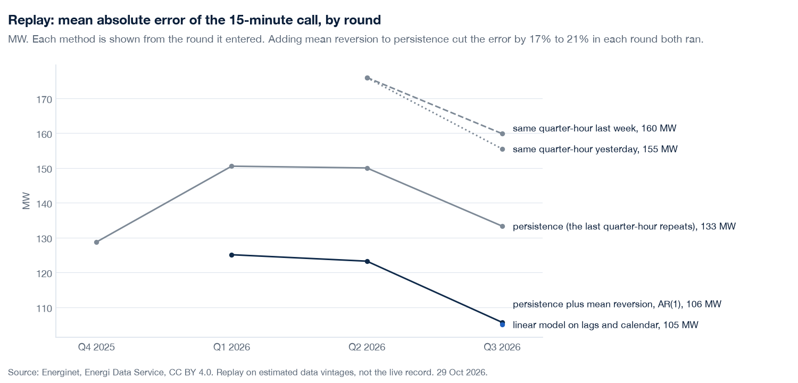

# nordcast

Short-term forecasts of the power imbalance in western Denmark (DK1), published every quarter-hour and scored against the grid operator's first published number.

Energinet runs the Danish grid. Every 15 minutes it has to make up the difference between what was scheduled and what actually happened: if generation falls short it buys up-regulation, if there is too much it buys down-regulation. nordcast forecasts which way that will go and by how many megawatts, 15, 30 and 60 minutes ahead of each quarter-hour.

The point is the record rather than the model. Each forecast is written to a file before its deadline, hashed, and the day's hashes are timestamped with OpenTimestamps. Once Energinet publishes the outcome, the forecast is scored against that first number. Nothing is revised afterwards, so the table below includes the misses and the deadlines that were not met.

The forecast on the record today is persistence, the assumption that the next quarter-hour looks like the last one. A LightGBM model runs alongside it as a challenger. It is frozen and scored on exactly the same terms, but it only replaces persistence if it passes the test set out in advance in `notes/preregistration.md`, and not before 1 April 2027.


The upper panel is the forecast target, the balancing energy Energinet activated in each quarter-hour. The lower panel is the main thing a model can see coming: wind generation arriving above or below the day-ahead forecast.

## Scorecard

Updated by the scoring job after each day's forecasts are timestamped. The record started on 28 October 2026 and the jobs only began running on a timer on 29 October, so for now the numbers say very little. In particular the on-time share starts low and will rise as the days accumulate.

<!-- scorecard -->
| horizon | method | calls | direction hit | pinball vs persistence (90 % CI) | coverage q10–q90 | on-time | live since |
|---|---|---|---|---|---|---|---|
| 15 min | headline | 6 | 0.0 % | +0.0 MW (+0.0 to +0.0) | 83.3 % | 5.9 % | 28 Oct 2026 |
| 15 min | lightgbm_v1 (challenger) | 3 | 66.7 % | +0.6 MW (+0.0 to +1.1) | 66.7 % | 3.0 % | 29 Oct 2026 |
| 30 min | headline | 5 | 20.0 % | +0.0 MW (+0.0 to +0.0) | 100.0 % | 4.9 % | 28 Oct 2026 |
| 30 min | lightgbm_v1 (challenger) | 2 | 0.0 % | -0.7 MW (-1.3 to +0.0) | 50.0 % | 2.0 % | 29 Oct 2026 |
| 60 min | headline | 3 | 0.0 % | +0.0 MW (+0.0 to +0.0) | 100.0 % | 2.9 % | 28 Oct 2026 |
<!-- /scorecard -->

Calls is the number of scored forecasts at that horizon. Direction hit is how often the forecast named the right direction (up, down, or neither). The pinball column compares the volume forecast with plain persistence, in MW, with a 90% bootstrap interval; positive is better, and for persistence itself it is zero by definition. Coverage is how often the actual value fell inside the published 10th to 90th percentile range, where 80% is the target. On-time is the share of forecasts due since the start that were frozen inside their window.

## Before going live

The methods were rehearsed on 2025 and 2026 data in quarterly rounds, each adding one method to the ladder. This used reconstructed data, so it is not part of the record, but it is why persistence with mean reversion is next in line.



The full log of each round, with the configuration and the review, is in `notes/replay-log.md`.

## Running it

The jobs run on one Mac against a local Supabase database.

```bash
uv sync --all-groups
ops/start_stack.sh                          # Colima and Supabase; Postgres on port 44332
uv run python jobs/pull_live.py             # load the latest feeds
uv run --group models python jobs/freeze.py # freeze whatever is due
uv run python jobs/score.py                 # score whatever has an outcome
uv run pytest
```

`ops/install.sh` sets up three launchd agents: an archive job every minute, the forecasting jobs every minute, and the database stack at login. The two charts above are rebuilt by the scripts in `notebooks/`; the command is in each docstring.

## Where things are

- `src/nordcast/` is the code: data sources, the schedule, freezing, scoring, the scorecard, backups.
- `jobs/` has one script per scheduled step and `ops/` the launchd agents that call them.
- `forecasts/frozen/` holds every frozen forecast with its hash and timestamp proof.
- `notes/` is the working record: the plan, the pre-registration, the data register, model cards and the incident log. `docs/README.md` explains how they fit together.
- `replay/` has the rehearsal rounds, `tests/` the tests, `supabase/migrations/` the schema.

Raw feeds are archived every minute to a private repository, `nordcast-archive`, so that first prints are never lost, and the database is backed up hourly to `nordcast-backups`.

## Data

Energinet's Energi Data Service, CC BY 4.0: imbalance prices and direction, the real-time power system feed, five-minute production and forecasts, and mFRR activations and requests. eSett is used as a second source for prices.

Related work: `jacobazu/dk1-imbalance-forecasting` back-tests DK1 imbalance spreads, `siddiqov/dk-power-imbalance-trading` fits CatBoost to DK1 and DK2 imbalance prices, and `nordic-balancing` provides clients for eSett, Energinet and Fingrid prices. What this project adds is the record itself: frozen, hashed, timestamped forecasts scored against the first print, a separate direction call, and a replay log.
