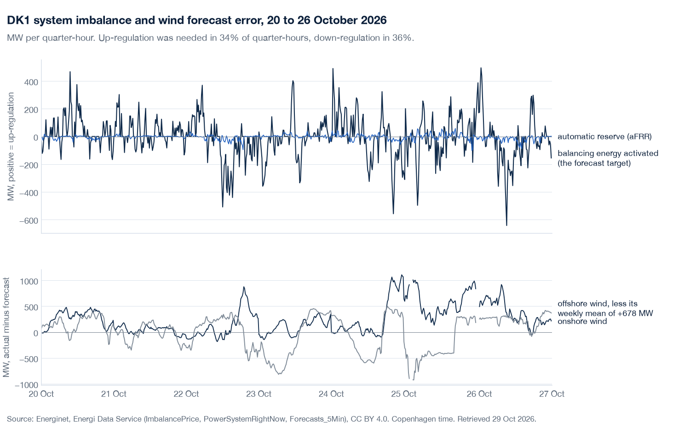

# nordcast

DK1 imbalance calls, direction (up / down / none) and volume (q10/q50/q90 MW), 15, 30 and 60 minutes before each 15-minute ISP.
Every call is frozen before its deadline, hashed, stamped daily with OpenTimestamps and scored against Energinet's first print.
The headline is persistence; LightGBM v1 runs beside it as a challenger and can take the call only as `notes/preregistration.md` says, 1 Apr 2027 at the earliest.

<!-- scorecard -->
| horizon | method | calls | direction hit | pinball vs persistence (90 % CI) | coverage q10–q90 | on-time | live since |
|---|---|---|---|---|---|---|---|
| 15 min | headline | 2 | 0.0 % | +0.0 MW (+0.0 to +0.0) | 50.0 % | 2.1 % | 28 Oct 2026 |
| 30 min | headline | 2 | 50.0 % | +0.0 MW (+0.0 to +0.0) | 100.0 % | 2.1 % | 28 Oct 2026 |
| 60 min | headline | 2 | 0.0 % | +0.0 MW (+0.0 to +0.0) | 100.0 % | 2.1 % | 28 Oct 2026 |
<!-- /scorecard -->

Prior art: `jacobazu/dk1-imbalance-forecasting` (backtests DK1 quarter-hour imbalance spreads), `siddiqov/dk-power-imbalance-trading` (CatBoost on DK1/DK2 imbalance prices) and `nordic-balancing` (clients for eSett, Energinet and Fingrid prices). What nordcast adds: frozen, hashed, timestamped calls scored against the first print; the direction class; the replay log (`notes/replay-log.md`); published intervals. Pre-registration: `notes/preregistration.md`. Data: Energinet (CC BY 4.0).
