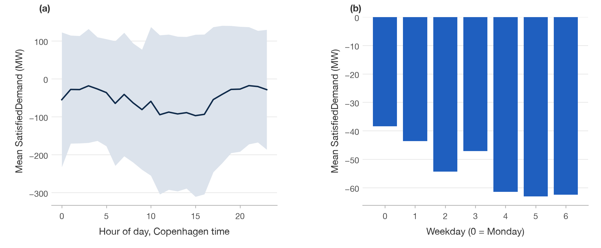

# Notes on the notes

The files in `notes/` were written while building nordcast, so they use short names and internal numbering. This page is the map.

The idea is simple. A forecast is only worth trusting if you can prove when it was made. So every forecast is written to disk before its deadline, hashed, timestamped, and later scored against the first number Energinet publishes. That scored history is what the notes call "the record". Everything else exists either to keep the record running on time or to decide which method should be making the forecast.

## The plan and its gates

`notes/nordcast-plan.md` sets out the build in phases. Phase 0 was the archive job that saves Energinet's live feeds every minute, so that first prints are never lost. Phase 1 is the record itself: the store, the baselines, persistence running live, LightGBM as a challenger, scoring, daily timestamps and a heartbeat. It is done when 30 days in a row have at least 99% of forecasts frozen on time with no open incident (gate G1). Phase 2 asks what the forecast is worth as a 10 MW position and tries zero-shot foundation models as challengers; it closes after 90 days live with the challenger either promoted or explicitly not (gate G2). Phases 3 and 4, risk limits and a website, are designed but not started. "Step" and "stone" in commit messages refer to the weekly rows in the phase 1 table.

## What each file is

- `nordcast-plan.md`: the plan above.
- `preregistration.md`: the test a challenger has to pass before it becomes the published forecast, fixed before the test began. Binding; changes only by dated amendment.
- `incidents.md`: every missed window and job failure, with cause and fix.
- `sources.md`: the data register, one entry per Energinet dataset with columns, units and sign convention, and the checks that confirmed the sign.
- `inception.md`: the first available row of each dataset and where the backfill started.
- `replay.md` and `replay-log.md`: how the rehearsal works and what each round found.
- `controls.md`: the controls the other notes cite by section number.
- `limits.md`: the simulated trading limits, 10 MW and EUR 5,000 a day.
- `backfill.md`, `data-alternatives.md`: how history was loaded, and which other sources were considered and why not.
- `from-energy-forecasting.md`, `source-repo-context.md`: what was carried over from the sister project.
- `models/`: model cards for the LightGBM direction and volume models.
- `later/`: designs for phases 2 to 4, parked until their gate opens.

## The replay

`replay/` holds four quarterly rounds, Q4 2025 to Q3 2026. Each round has a plan (which methods run), a scorecard, diagnostics and a review, and each adds one method to the ladder. The method with the lowest mean pinball loss across the three horizons wins the round and becomes the model for the next. The replay uses estimated data vintages, so it flatters every method a little and is kept apart from the live record.

For each round, `jobs/replay_charts.py` draws three charts of the target from the first prints published before that round. The latest round's hourly profile:

*Figure: The target averages −97 MW at 15:00 and −18 MW at 21:00 by Copenhagen hour. Source: Energinet, Energi Data Service (observation table, first prints before the round); CC BY 4.0; as of 2026-07-01.*

The other charts, by round:

- 2025q4: [autocorrelation](../replay/2025q4/analysis/acf.png), [distribution](../replay/2025q4/analysis/distribution.png), [profiles](../replay/2025q4/analysis/profiles.png); notes in [analysis.md](../replay/2025q4/analysis/analysis.md)
- 2026q1: [autocorrelation](../replay/2026q1/analysis/acf.png), [distribution](../replay/2026q1/analysis/distribution.png), [profiles](../replay/2026q1/analysis/profiles.png); notes in [analysis.md](../replay/2026q1/analysis/analysis.md)
- 2026q2: [autocorrelation](../replay/2026q2/analysis/acf.png), [distribution](../replay/2026q2/analysis/distribution.png), [profiles](../replay/2026q2/analysis/profiles.png); notes in [analysis.md](../replay/2026q2/analysis/analysis.md)
- 2026q3: [autocorrelation](../replay/2026q3/analysis/acf.png), [distribution](../replay/2026q3/analysis/distribution.png); notes in [analysis.md](../replay/2026q3/analysis/analysis.md)

## The layers

`docs/layers/` holds side studies built on the record, each with a README and a risk note written before the code. They are numbered after the sister project's catalogue (for example "Layer #32"). Each ends by saying whether it adds forecasting value; most do not.

## The jobs

Four launchd agents on one Mac, installed by `ops/install.sh`. The archive agent pulls the live feeds every minute into the `nordcast-archive` repository. The jobs agent, also every minute, loads, freezes and scores; after midnight Copenhagen time it timestamps the day and rewrites the README scorecard; every 5 minutes it writes a local health check, `status/heartbeat.json`, and raises a Mac notification if freezes or pulls have gone stale; once an hour it backs up the database to `nordcast-backups`. The stack agent starts Colima and Supabase at login. A watchdog agent reloads any of them launchd has lost. Only the jobs push to GitHub, and only their own commits. GitHub is used only as a repository, with no workflows, so nothing outside the Mac raises an alert if the Mac itself is off.

## Figures

Every chart is drawn through `src/nordcast/paper_style.py` at the size it prints (3.4 or 7.0 in wide, serif 6 to 9 pt) and written as a vector PDF (Type 42 fonts), a 300 dpi PNG and a LaTeX caption file `<name>.tex` next to it. The finding, units, source and as-of date live in that caption, not on the image. The PNG keeps the name the READMEs link to. `FIGURES.md` is the specification; `jobs/export_paper_figures.py --check` gathers the figures for a paper and checks the PDFs. To redraw one, run its script with `uv run --all-groups python <script>`: `notebooks/build_02_replay.py`, the `chart.py` of each layer, `docs/experiments/stability/run.py`, `jobs/replay_charts.py` (the replay round analysis charts, read-only) and the notebooks `build_01`, `03`, `10`, `11`, `12` followed by `jupyter nbconvert --execute --inplace`. `tests/test_paper_style_guard.py` fails if a script draws a figure any other way.
