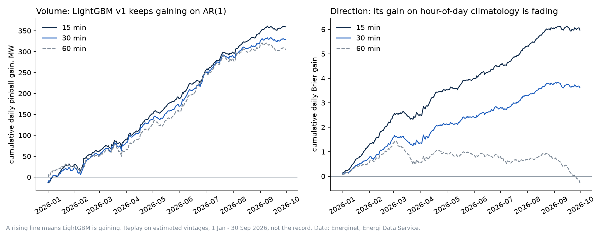

# Experiment: is any model's edge significant and stable? (30 Oct 2026)

**In plain English.** Is any model's lead real, and does it last? The model's lead on forecast size looks real and steady. Its lead on direction is smaller and fading. This is a rehearsal on past data, and the live test is the one that counts.

The replay and the model cards compared average losses. This asks the two further questions a forecast evaluation owes its reader: is the difference distinguishable from noise, and did it hold over time or come from one stretch? It runs on the replay's 2026 rounds, 273 days, out of sample, with LightGBM v1 refit before each round. The test is Diebold–Mariano on daily mean loss differences with Newey–West errors over 7 lags ([run.py](run.py), results in [results.csv](results.csv)). This is research on estimated vintages. It changes nothing in the record or the pre-registration.

**Volume: LightGBM's lead is real and steady.** It beats AR(1) by 1.1 to 1.3 MW of pinball a day, about 3 %, with t between 4.7 and 7.0 and no trend over the nine months. Both beat persistence by 9 to 12 MW, with t above 26. This bodes well for the pre-registered volume conditions, though the live test on exact vintages is the one that counts.

**Direction: the lead over climatology is real at 15 and 30 minutes, and fading.** The mean gain in Brier is 0.022 at 15 minutes (t 6.8) and 0.013 at 30 (t 4.7), but both trend down significantly (t −3.1 and −2.1). At 15 minutes the fitted gain falls from about 0.036 in January to about 0.008 in September, and the path visibly flattens around the 4 Mar 2026 definition change. At 60 minutes there is no gain at all (t −0.3), and it ends the period below where it started. So the direction condition added by Amendment 1 could fail in the live window. That is what the amendment is for, and nothing here is a reason to change it.

**A correction to the replay.** The 2026q3 review called the linear model and AR(1) "within noise". Over the three rounds the linear model is ahead by 0.35 to 0.58 MW, with t of 2.7, 3.5 and 3.6. That is less than 2 % of the loss, and the 15-minute result would not survive a correction for the 15 comparisons made here (it needs t of about 2.9), but the two are not simply indistinguishable.

**What could flatter these numbers.** v1's settings were chosen on 10 Aug to 27 Oct, inside this sample, so every pair was re-run on the 221 days before 10 Aug: the conclusions hold, with v1 over AR(1) at t 5.2 to 6.7 and direction at 15 minutes at t 7.1. All inputs are estimated vintages. Every line flattens in September, and three weeks can't say whether that is noise or the start of something, so the live scorecard is worth watching for it. AR(1) nests persistence, which makes Diebold–Mariano conservative for that pair; at t above 26 it makes no difference.
