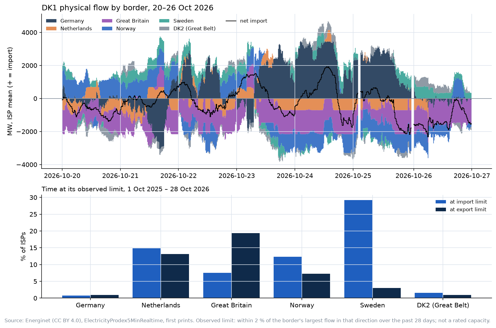

# Layer: DK1 interconnector flows (#33): six borders, every 5 minutes, and how often each sits at its limit

**Status:** built and tested, uncommitted, 29 Oct 2026. Six series are loaded into nordcast's local record (backfilled from 1 Mar 2025 as estimated vintages; live pulls add exact ones). Nothing about the frozen calls, the challenger or the pre-registration changed. The risks were written down before any code: [RISK.md](RISK.md). The test: [backtest.py](backtest.py), results in [backtest.csv](backtest.csv).

## In one paragraph

DK1 sits between Germany, the Netherlands (COBRA), Great Britain (Viking Link), Norway (Skagerrak), Sweden (Konti-Skan) and DK2 (the Great Belt). Energinet's 5-minute feed carries the physical flow on each, and each one matches Energinet's hourly settlement for that border at correlation 1.000 (0.999 for the Great Belt), with + = import on all six. Capacities aren't published openly, so the layer measures each border against its own observed limit: in **71 %** of ISPs since 1 Oct 2025, at least one border was at its limit. Sweden sat at its import limit 29 % of the time, Great Britain at its export limit 19 %, the Netherlands at one limit or the other 28 %; Germany and the Great Belt, the links that flex, were at a limit under 3 % of the time.

## The energy-analyst skill

The conventions here come from the energy-analyst skill, a reference distilled from about 170 trading manuals, energy textbooks and journal articles. Its interconnector notes are written for GB ("normalise to 'import to GB = +'", `gas-power-metals.md` §C6) and its utilisation chart for gas interconnectors (#25) is flow ÷ capacity with a 90 % binding line. This layer applies the sign rule to DK1 and, with no open power capacity data, replaces capacity by an observed limit. Its forecast-evaluation rules (`SKILL.md` §18) set the test below.

## Your questions

**What do we build?**
- Six point-in-time series, `energinet.dk1.flow_{de,nl,gb,no,se,dk2}_mw`, ISP means from the 5-minute feed nordcast already archives. Migration `20261029210000_interconnectors.sql`, six `SERIES` entries in `sources/energinet.py`.
- A test per border that pins it to settlement on a fixed week (correlation > 0.99, bias under 50 MW).
- The chart above ([chart.py](chart.py)) and the back-test.

**What does it forecast?**
- Nothing. Scheduled (commercial) flows and capacities aren't open on Energi Data Service, so the layer can't say what the flows were planned to be, only what they were.

**What does it invent or improve?**
1. **An open, real-time, settlement-checked split of DK1's net import by border**, with one sign convention.
2. **An "at its limit" measure without capacity data:** within 2 % of the border's largest flow in that direction over the previous 28 days, known at the time. It is an observed limit, not a rating: a link that never reached its rating looks smaller, and a link whose limit moves (Norway capped at 1,387 MW one week and 1,139 MW another) is tracked as it moves. Checked against day-ahead prices in layer #31 ([price-coupling](../price-coupling/README.md)): it holds for the HVDC links (Sweden and Norway sit at their limit far more often when DK1's price splits from theirs), not for Germany, whose limit moves too much for a 28-day maximum.

**How do we validate it?**
- **The series:** each border against `ProductionConsumptionSettlement`, hourly, 1–7 Aug and 1–7 Oct 2026: correlation 1.000 (0.999 Great Belt), bias within ±12 MW. Re-checked in CI on the October week (`tests/test_interconnectors.py`).
- **Its value for the imbalance call:** the back-test.

**Is it alpha?**

**No.** Four features known at the freeze (borders at their import limit, at their export limit, the 1-hour ramp of net import, the 1-hour ramp of the German flow), added with the replay's weekly refit and scored out of sample on its 2026 rounds. Gain = mean daily fall in absolute error, day-block bootstrap 90 % interval:

| h | round | on top of rung 4 | on top of rung 4 + residual load (#32) |
|---|---|---|---|
| 15 | 2026q1 | +0.9 (+0.2 to +1.5) | −0.1 (−0.7 to +0.4) |
| 15 | 2026q2 | +1.1 (+0.4 to +1.8) | +0.0 (−0.2 to +0.2) |
| 15 | 2026q3 | +0.0 (−0.5 to +0.6) | −0.0 (−0.2 to +0.2) |
| 30 | 2026q1 | +0.7 (+0.2 to +1.2) | +0.0 (−0.5 to +0.4) |
| 30 | 2026q2 | +0.7 (+0.1 to +1.3) | −0.1 (−0.3 to +0.1) |
| 30 | 2026q3 | −0.4 (−0.9 to +0.0) | −0.0 (−0.2 to +0.2) |
| 60 | 2026q1 | +0.2 (−0.2 to +0.5) | −0.1 (−0.5 to +0.3) |
| 60 | 2026q2 | +0.4 (−0.0 to +0.9) | +0.2 (−0.0 to +0.5) |
| 60 | 2026q3 | −0.6 (−1.0 to −0.3) | −0.2 (−0.4 to +0.1) |

MAE is 105–129 MW throughout. On top of residual load the flows add nothing: every interval straddles zero. On top of rung 4 alone they show the same small, fading pattern as residual load (they share net import), turning negative by 2026q3. Not an edge.

**What are we proposing?**
- Keep the six series in the record (no new API calls; each is checked against settlement) and the limit shares on the page.
- Don't add them to the model.
- If ENTSO-E access (a token) is ever set up, the real test is the scheduled flow against the physical one, and flow against published capacity; neither is possible from open, keyless data today.

**What does it give the community and the energy space?**
- DK1's six borders in one sign convention, checked against settlement, and how often each is at its limit, from open data only. The headline: DK1 is constrained most of the time (71 % of ISPs), mostly on the HVDC links to Sweden, Great Britain, the Netherlands and Norway, while the German AC border and the Great Belt carry the swings.

## Files (uncommitted)

- `supabase/migrations/20261029210000_interconnectors.sql` (applied to the local database)
- `src/nordcast/sources/energinet.py`: six `energinet.dk1.flow_*_mw` entries
- `tests/test_interconnectors.py`
- `docs/layers/interconnectors/`: this README, RISK.md, backtest.py, backtest.csv, chart.py, interconnectors.png

## Not done

- No capacity and no scheduled flows (not open).
- No DK2 borders.
- No price coupling: whether a binding border splits DK1's price from its neighbour's would need the neighbours' day-ahead prices; that belongs with #31.
