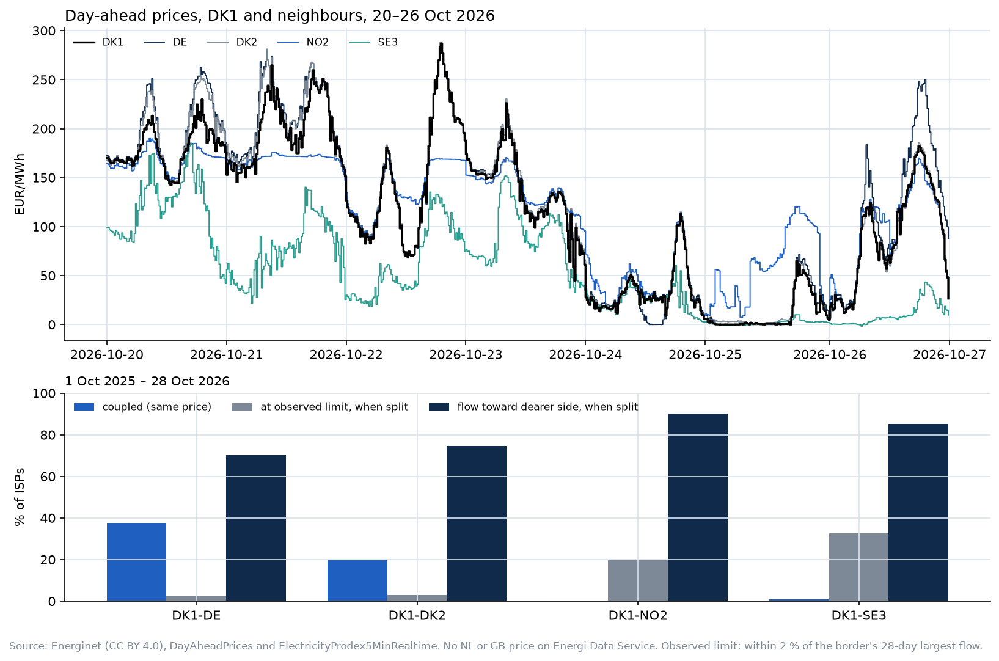

# Layer: DK1 price coupling (#31, DK1 part): when DK1's day-ahead price splits from its neighbours, and whether the flows follow

**Status:** analysis built, uncommitted, 29 Oct 2026. **Nothing is added to the record:** neighbour prices are cached outside it (`data/history/DayAheadPricesAll/`, gitignored), because adding areas means changing nordcast's DK1-only fetch and live loader, and the test below gives no reason to. The risks were written down before any code: [RISK.md](RISK.md). The test: [backtest.py](backtest.py), results in [coupling.csv](coupling.csv) and [backtest.csv](backtest.csv).

## In one paragraph

Energi Data Service publishes 15-minute day-ahead prices for DK1 and four of its six neighbours: Germany, DK2, Norway (NO2) and Sweden (SE3); the Netherlands and Great Britain aren't there. Since 1 Oct 2025, DK1 has had the same price as Germany in **38 %** of ISPs and as DK2 in 20 %, but almost never as Norway (0.4 %) or Sweden (0.8 %); all four matched in 0.3 %. Splits line up with layer #33's flows: when DK1 and Sweden split, the Konti-Skan link was at its observed limit 33 % of the time (3 % when coupled), and for Norway 20 % (4 %). When prices split, the physical flow ran toward the dearer side 90 % of the time on Norway, 85 % on Sweden, 75 % on DK2 and 70 % on Germany; the rest is intraday and balancing flow that the day-ahead auction doesn't set.

## The energy-analyst skill

The framing comes from the energy-analyst skill, a reference distilled from about 170 trading manuals, energy textbooks and journal articles. Its catalogue entry #31 starts with Ireland/GB (another session's); this is the DK1 part. Two of its rules shaped the layer: power regions don't transfer (`SKILL.md` §12, "a model calibrated on one region does not apply to another"), so nothing is assumed from GB or Ireland; and a spread is "a spread until cargo evidence says otherwise" (§21, written for inter-basin spreads; here the evidence is the measured flow), which is why the spreads are checked against the measured flows rather than read on their own. Its forecast-evaluation rules (§18) set the test.

## Your questions

**What do we build?**
- A monthly cache of day-ahead prices for DK1, DE, DK2, NO2 and SE3 since 1 Oct 2025 (15-minute day-ahead from that date), and the spreads DK1 − neighbour.
- A coupling check against the #33 flows, and an out-of-sample test of the spreads as an input to the imbalance call.
- The chart above ([chart.py](chart.py)).

**What does it forecast?**
- Nothing on its own. The spreads for the delivery ISP are known the day before, so they could be inputs at every freeze; the test says they don't help.

**What does it invent or improve?**
1. **A check on layer #33's "observed limit"**, which had no capacity data behind it: it holds where the links are HVDC (Sweden, Norway), where a split comes with the link at its limit far more often than a coupled ISP does. It fails for Germany (at its limit only 2.4 % of split ISPs): the German border's limit moves too much for a 28-day maximum to find it.
2. **How far DK1's physical flows follow the day-ahead price**, per border, from open data.

**How do we validate it?**
- The prices are Energinet's published auction results; the flows are #33's settlement-checked series. The coupling numbers are counts over 37,728 ISPs per border.

**Is it alpha?**

**No.** The target ISP's four spreads and the number of split borders, known the day before, added with the replay's weekly refit and scored out of sample on its 2026 rounds (mean daily fall in absolute error, day-block bootstrap 90 % interval):

| h | round | on top of rung 4 | on top of rung 4 + residual load (#32) |
|---|---|---|---|
| 15 | 2026q1 | −0.2 (−0.7 to +0.3) | −0.2 (−0.6 to +0.1) |
| 15 | 2026q2 | +0.1 (−0.5 to +0.8) | −0.1 (−0.8 to +0.5) |
| 15 | 2026q3 | −0.7 (−1.1 to −0.3) | −0.5 (−0.7 to −0.2) |
| 30 | 2026q1 | −0.3 (−0.8 to +0.2) | −0.3 (−0.8 to +0.1) |
| 30 | 2026q2 | +0.3 (−0.4 to +1.0) | +0.0 (−0.7 to +0.7) |
| 30 | 2026q3 | −0.8 (−1.3 to −0.3) | −0.6 (−0.9 to −0.2) |
| 60 | 2026q1 | −0.3 (−0.9 to +0.3) | −0.3 (−0.9 to +0.2) |
| 60 | 2026q2 | +0.4 (−0.4 to +1.2) | +0.2 (−0.6 to +1.0) |
| 60 | 2026q3 | −1.0 (−1.5 to −0.4) | −0.8 (−1.3 to −0.3) |

MAE is 105–129 MW. No round improves clearly, and 2026q3 is worse at every horizon. Linear and untested non-linearly, as in #32 and #33.

**What are we proposing?**
- Keep this as an analysis page, not a record series; don't change the DK1-only fetch for it.
- Use its first finding to qualify #33: "at its observed limit" is meaningful for the HVDC links, not for Germany.

**What does it give the community and the energy space?**
- From open data only: how often DK1 is priced with each neighbour, and how often its physical flows follow the day-ahead price. DK1 is a German-priced area that is almost never priced with the Nordics.

## Files (uncommitted)

- `docs/layers/price-coupling/`: this README, RISK.md, backtest.py, coupling.csv, backtest.csv, chart.py, price_coupling.png
- Cache (gitignored, rebuilt by backtest.py): `data/history/DayAheadPricesAll/<yyyy-mm>.parquet`

## Not done

- NL and GB prices (not on Energi Data Service).
- Ireland/GB itself (#31's first part, another session's).
- No record series, no live job.
