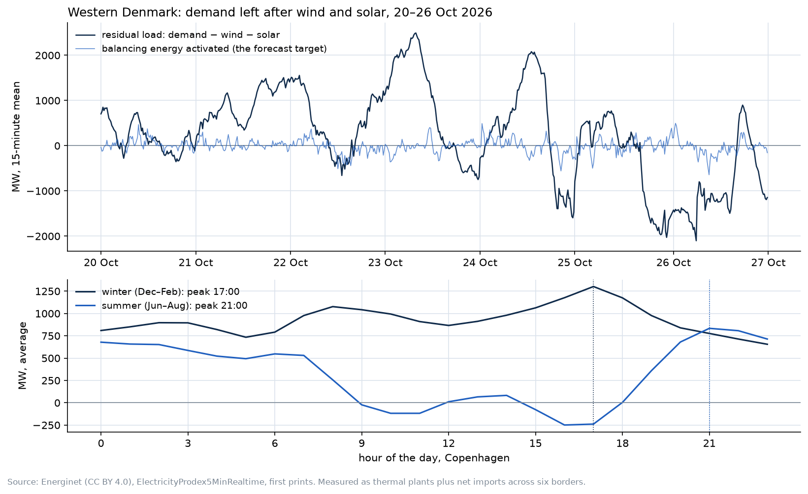

# Layer: DK1 residual load (#32): demand − wind − solar, measured every 5 minutes

**In plain English.** Residual load is the demand left after wind and solar, which other plants and imports must cover. This layer measures it every 5 minutes and checks it against Energinet's later settled figures. It doesn't produce a forecast of its own.

**Status:** built and tested, uncommitted, 29 Oct 2026. The series is loaded into nordcast's local record (backfilled from 1 Mar 2025 as estimated vintages; live pulls add exact ones). Nothing about the frozen calls, the challenger or the pre-registration changed. The risks were written down before any code: [RISK.md](RISK.md). The test that decided the alpha question: [backtest.py](backtest.py), results in [backtest.csv](backtest.csv).

## In one paragraph

Residual load is the part of demand that wind and solar don't cover, so thermal plants and the interconnectors have to. Energinet publishes no real-time DK1 consumption, and a consumption derived from the 5-minute feed is wrong in summer: it misses part of the rooftop solar and runs up to ~700 MW low at midday (1–7 Aug 2026). Residual load doesn't have that problem. By energy balance it equals **thermal production + net import**, and solar that the feed can't see drops out of both sides. Measured that way from `ElectricityProdex5MinRealtime`, it matches Energinet's own hourly settlement with **correlation 1.000** in both check weeks (mean −2 MW in October, +50 MW in August under the old settlement method). It is published every 5 minutes, about 5 minutes behind; settlement comes a day or more later.

## The energy-analyst skill

The domain conventions here come from the energy-analyst skill: a reference distilled from about 170 trading manuals, energy textbooks and journal articles (a core of 89 PDFs, extended on 27 Oct 2026 with four reference files from about 80 more), keeping dated figures tagged and unconfirmed items marked to verify. This layer took three things from it: the residual-load definition and the rule to name any variant (`gas-power-metals.md` §C3), the peak window read from the data rather than hard-coded, and the forecast-evaluation rules (`SKILL.md` §18) whose stability check turned a small Q1 gain into a "no". Its power data map doesn't cover Denmark, so the Energinet sources and checks were worked out here (RISK.md).

## Your questions

**What do we build?**
- One point-in-time series, `energinet.dk1.residual_load_mw`: ISP mean of plants <100 MW + plants ≥100 MW + six exchanges (+ = import, tested), from the 5-minute feed nordcast already archives. Migration `20261029200000_residual_load.sql`, one `SERIES` entry in `sources/energinet.py`.
- A test that pins it to settlement on a fixed week (correlation > 0.99, bias under 100 MW), so a sign or column change at Energinet fails CI.
- The chart above ([chart.py](chart.py)) and the back-test.

**What does it forecast?**
- Nothing on its own, and it can't yet: there is no open DK1 consumption forecast, so the only forecastable part of residual load is the renewables (already in nordcast's day-ahead wind and solar series).

**What does it invent or improve?**
1. **A measured, real-time DK1 residual load from open data,** checked against settlement. Most public residual-load series are computed as forecast demand − forecast renewables, or from settlement days later.
2. **A documented reason not to publish real-time DK1 consumption** from this feed (the summer rooftop-solar gap), with the numbers.
3. **The peak hour, read from the data:** 17:00 in winter (Dec–Feb, mean 927 MW), 21:00 in summer (Jun–Aug, mean 319 MW). In summer it sits near or below zero from 09:00 to 18:00 Copenhagen time, lowest at 16:00 (−249 MW): DK1 exports its surplus. The energy-analyst skill's rule holds here too (`gas-power-metals.md` §C3): derive the peak window from the data each season, never hard-code 17:00–19:00.

**How do we validate it?**
- **The series:** against `ProductionConsumptionSettlement` (thermal + hydro + unknown + exchanges), hourly, 1–7 Aug and 1–7 Oct 2026, either side of the 1 Sep 2026 settlement method change: correlation 1.000 / 1.000, mean +50 / −2 MW, MAE 51 / 24 MW. Re-checked in CI on the October week (`tests/test_residual_load.py`).
- **Its value for the imbalance call:** the back-test below.

**Is it alpha?**

**No, not as a linear input to the imbalance call.** The back-test adds three features known at the freeze (latest residual load, its 1-hour ramp, its change from the same ISP a week earlier) to the replay's rung 4 (target lags + calendar), with and without the renewables' day-ahead errors that lightgbm_v1 already uses. Weekly refits, scored out of sample on the replay's three 2026 rounds, gain = mean daily fall in absolute error with a day-block bootstrap 90 % interval:

| h | round | MAE rung 4 | gain from residual load | MAE with renewables | gain on top of renewables |
|---|---|---|---|---|---|
| 15 | 2026q1 | 124.0 | +0.9 (+0.0 to +1.7) | 123.7 | +1.5 (+0.5 to +2.4) |
| 15 | 2026q2 | 122.1 | +1.0 (+0.3 to +1.7) | 123.1 | −0.9 (−1.9 to −0.0) |
| 15 | 2026q3 | 104.9 | +0.1 (−0.5 to +0.6) | 104.8 | −0.1 (−0.7 to +0.4) |
| 30 | 2026q1 | 126.8 | +0.7 (−0.1 to +1.4) | 126.7 | +1.1 (+0.3 to +1.9) |
| 30 | 2026q2 | 123.4 | +0.6 (−0.0 to +1.3) | 124.4 | −0.9 (−1.7 to −0.1) |
| 30 | 2026q3 | 105.9 | −0.4 (−0.9 to +0.1) | 105.9 | −0.5 (−0.9 to +0.0) |
| 60 | 2026q1 | 129.0 | +0.2 (−0.3 to +0.7) | 129.1 | +0.4 (−0.1 to +0.9) |
| 60 | 2026q2 | 125.8 | +0.1 (−0.4 to +0.5) | 126.3 | −0.6 (−1.1 to −0.1) |
| 60 | 2026q3 | 107.5 | −0.5 (−0.8 to −0.2) | 107.4 | −0.4 (−0.7 to −0.2) |

Every gain is under 1.5 MW on an error of 105–129 MW (about 1 % at best), and the sign turns from the first quarter to the third, significantly negative at 60 min in 2026q3. That is a historical observation, not an edge (energy-analyst `SKILL.md` §18: check stability, not just the average). Untested: a non-linear use (lightgbm) and residual load's own forecast error, which needs a consumption forecast nobody publishes openly. Either would be a v2 question with its own pre-registration; lightgbm_v1's inputs stay as registered.

**What are we proposing?**
- Keep the series in the record (it costs no new API calls and is exact) and show it beside the imbalance chart.
- Don't add it to the model on this evidence.
- If a v2 model is tried, test residual load there non-linearly, pre-registered, rather than adding it now.

**What does it give the community and the energy space?**
- A free, real-time, settlement-checked DK1 residual-load series and a short note on why the "obvious" real-time consumption (production + net import) is wrong in summer, with the size of the error. Anyone deriving Danish demand from `ElectricityProdex5MinRealtime` hits that gap.

## Files (uncommitted)

- `supabase/migrations/20261029200000_residual_load.sql` (applied to the local database)
- `src/nordcast/sources/energinet.py`: the `energinet.dk1.residual_load_mw` entry
- `tests/test_residual_load.py`
- `docs/layers/residual-load/`: this README, RISK.md, backtest.py, backtest.csv, chart.py, residual_load.png

## Not done

- No web page: nordcast has no site yet (stack-web-rust.md, phase 4).
- No DK2.
- No consumption forecast, so no residual-load forecast error.
