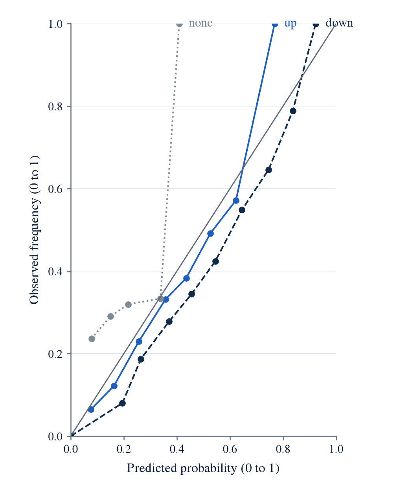
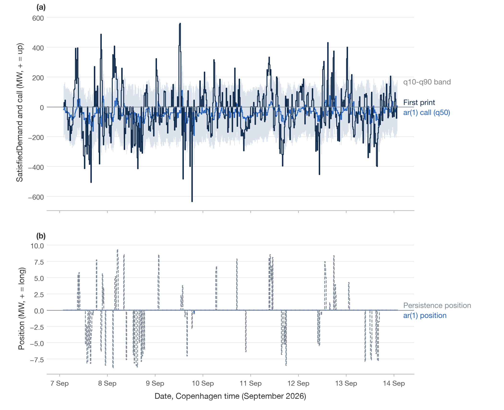
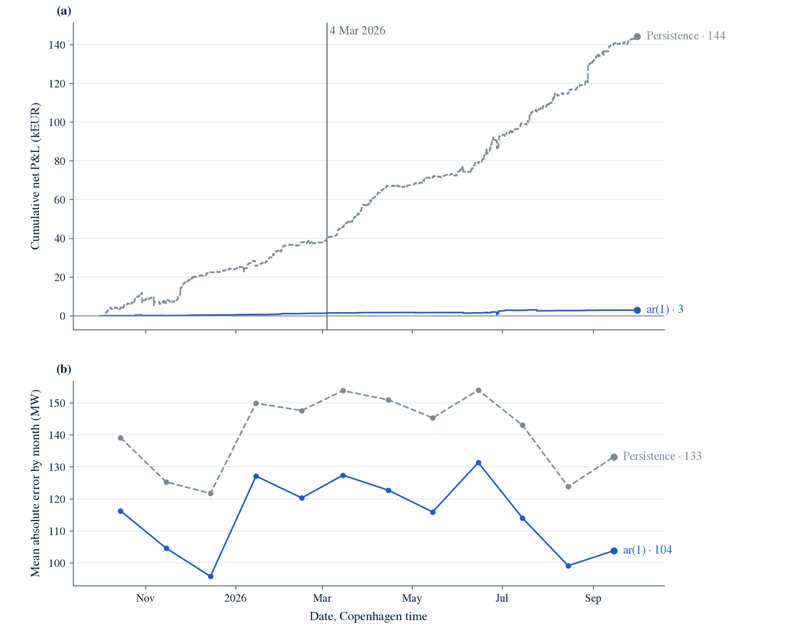
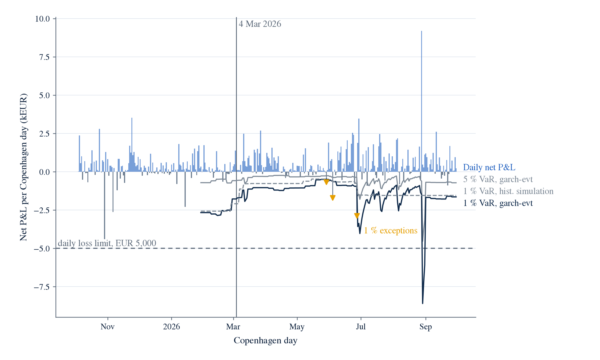

# Notebooks

Each notebook is written by its `build_*.py` script and then executed; the command is in each script's docstring. The chart of `01_look.ipynb` is the first one in the [root README](../README.md). The four below run on estimated vintages, so none of them is the record.

## 03: LightGBM v1 against persistence

[03_model.ipynb](03_model.ipynb) scores LightGBM v1 against persistence on the last 20 % of the window from 1 Oct 2025.

*Figure: At 15 min the up and down probabilities between 0.2 and 0.7 overstate the observed frequency by 7 percentage points on average. Source: Energinet, Energi Data Service; data/training/h15.parquet, models/holdout-lightgbm-v1-h15.pkl; CC BY 4.0; as of 2026-10-27.*

## 10: L1 position

[10_position.ipynb](10_position.ipynb): what each call would have meant as a position of at most 10 MW, ar(1) against persistence on the replay.

*Figure: In 7-13 Sep 2026 the ar(1) position matched the first print's direction in 0% of 1 positioned quarter-hours (replay, not the record). Source: Energinet, Energi Data Service (calls from jobs/layer_calls.py); CC BY 4.0; as of 2026-09-30.*

## 11: L2 P&L

[11_pnl.ipynb](11_pnl.ipynb): what the L1 positions would have made, holding into imbalance.

*Figure: Holding into imbalance 15 min ahead made ar(1) +3 kEUR net and persistence +144 kEUR over the replay year (replay, not the record). Source: Energinet, Energi Data Service (calls from jobs/layer_calls.py); CC BY 4.0; as of 2026-09-30.*

## 12: L3 risk

[12_risk.ipynb](12_risk.ipynb): value at risk on the daily net P&L of the L2 strategy, and whether each risk model knew.

*Figure: Persistence's daily P&L breached its 1 % garch-evt VaR on 3 of 365 replay days (replay, not the record). Source: Energinet, Energi Data Service (calls from jobs/layer_calls.py); CC BY 4.0; as of 2026-09-30.*
